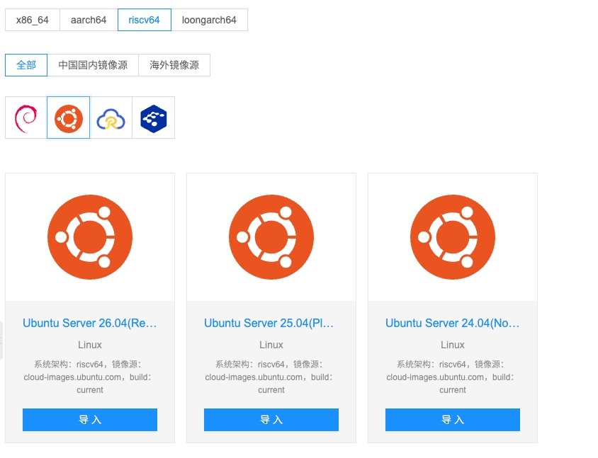

# Cloudpods 原生支持 riscv64 部署

[Cloudpods](https://github.com/yunionio/cloudpods) 原本支持 x86_64 和 aarch64。从 v4.1 版本开始，riscv64 正式加入 Cloudpods 的原生支持架构列表。



## 快速体验

在 RISC-V 操作系统上下载支持 riscv64 部署的最新 ocboot 安装包：

```bash
wget https://github.com/yunionio/ocboot/archive/refs/tags/master-v4.1.0-preview.tar.gz
tar xf master-v4.1.0-preview.tar.gz
cd ocboot-master-v4.1.0-preview
```


解压后执行：

```bash
./ocboot.sh run.py virt --version v4.1.0-20261022.0
```

即将一套all-in-one的cloudpods部署在 RISC-V 硬件上，控制面和计算节点都可以在 RISC-V 物理机上拉起。由于做了Cloudpods当前使用的k3s和calico 版本的 RISC-V 移植，因此也可以将 RISC-V 节点加入存量的cloudpods集群，也可以将x86或arm节点加入 RISC-V 的集群，实现三种异构架构的混合部署。

目前, Cloudpods RISC-V 适配版本为 v4.1.0-20261022.0，支持的操作系统版本包括：

| Operating system and Arch | 4.1.0-preview |
| --- | --- |
| openEuler 24.03 LTS SP3 riscv64 | ✅ |
| openEuler 24.03 LTS SP4 riscv64 | ✅ |
| Debian 13 riscv64 | ✅ |
| Ubuntu 24.04 LTS riscv64 | ✅ |
| Ubuntu 26.04 LTS riscv64 | ✅ |
| openRuyi 2026.9 riscv64 | ✅ |

## 做了哪些工作

Cloudpods 对 RISC-V 的支持是把一条完整的技术栈适配到 RISC-V 上，包括安装器（ocboot）、K3s 控制面、Calico 容器网络、Operator、QEMU 虚拟化、各组件服务镜像和软件包。改动横跨十多个仓库、几十个 PR，前后持续一年多。

整个工作的主要难点在于很多关键组件在上游没有可直接使用的产物。例如，K3s 的 riscv64 发布链需要自行修复和维护；Calico 官方没有可直接使用的 riscv64 镜像；BIRD、bpftool、iptables、ipset 以及 Calico 的 go-build 工具链，都需要重新构建或修改源码。为此，我们自行维护了 K3s 的riscv64构建，补齐1.28.5版本的 riscv64 二进制、离线镜像和安装包。自行维护了BIRD, bpftool，toolchain等calico以来的工具链的打包和编译，实现了 Calico v3.27 riscv64镜像的构建。这些工作实现了Cloudpods的基础底座在三个架构的统一，允许用户可以在一个集群纳入x86_64, arm64或riscv64的控制节点和计算节点。

因为Cloudpods软件构建基础设施已经在支持arm架构的时候打下了良好的基础，自研组件的riscv64架构迁移倒是顺利很多。但具体的工作还是比较繁杂和琐碎，持续了很长时间。每一个deb，rpm，服务镜像都需要支持三种架构，通过依赖向上游扩散，得支持依赖软件包和镜像的三种架构的支持，以及依赖的依赖的三种架构支持...

最后还需要有RISC-V硬件环境进行验证，中科院软件所和openRuyi社区给了我们给力的支持，提供了几台32GB内存且CPU支持硬件虚拟化（KVM）的spacemit X100服务器，使得我们可以在native的riscv64硬件上实现软件编译和打包，以及进行安装部署和验证。同时，openRuyi社区给Cloudpods社区提供了很多帮助，不仅支持了Cloudpods v4.0.3版本在openRuyi下的适配和集群功能验证，还给Cloudpods代码仓库贡献了PR，并且在基础OS，虚拟化等方面也提供了很多技术指导和帮助。

为了让 Cloudpods 社区第一时间体验 Cloudpods 对 RISC-V 的完整支持，我们提前fork出了 release/4.1 分支，发布了同时支持x86_64, arm64和riscv64架构的安装包和镜像，版本号为 v4.1.0-20261022.0 ，欢迎社区朋友们测试体验。

## 关于RISC-V

RISC-V 诞生于 2010 年加州大学伯克利分校，初衷是打破 x86 与 ARM 长期把持的指令集垄断：x86 封闭且由 Intel/AMD 主导，ARM 虽高效但IP由ARM公司主导。RISC-V 以“开源、免费、模块化”为核心，基础指令极简，允许企业自由扩展自定义指令，从物联网 MCU 到 AI 服务器 CPU 都能按需剪裁。

相比 x86/ARM，RISC-V的优势不在性能跑分，而在“可拥有、可改造”。RISC-V 是“开放标准+全球共建”，指令集公开、零授权费、无单点控制、扩展自由，软硬协同定制能力强，依托国际基金会与全球开发者，融入了全球化的生态体系，得到了主流Linux发行版的广泛支持，实现了**自主可控**与**全球生态**的兼得，特别适合异构算力与垂直场景。

当前 RISC-V 已占全球处理器出货约 1/4，嵌入式与边缘侧高度成熟，高性能路线（玄铁 C950、香山、spacemiT 等）开始切入服务器与 AI 推理场景。RVA23 等规范正补齐软硬件统一接口，生态从“能跑”走向“好用”。

在科技壁垒高筑、AI 大模型重塑算力的今天，RISC-V 提供了一个兼顾自主可控与全球生态的CPU架构选项，将在边缘 AI、具身智能、智算中心、车规与主权云中，成为最关键的开放算力底座。
